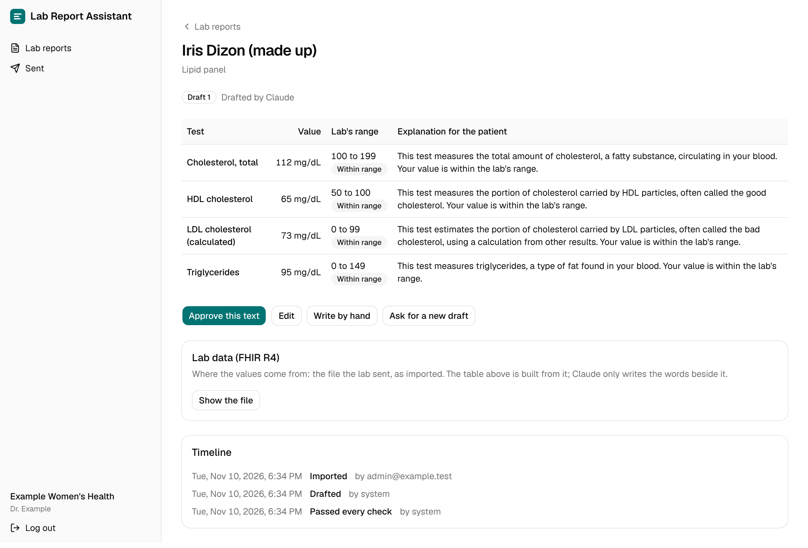
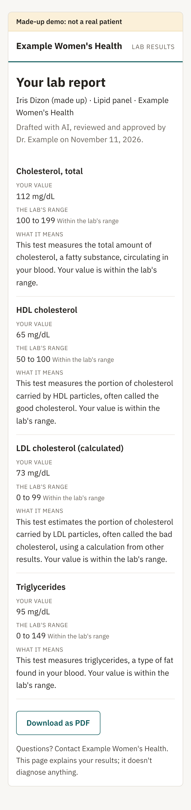
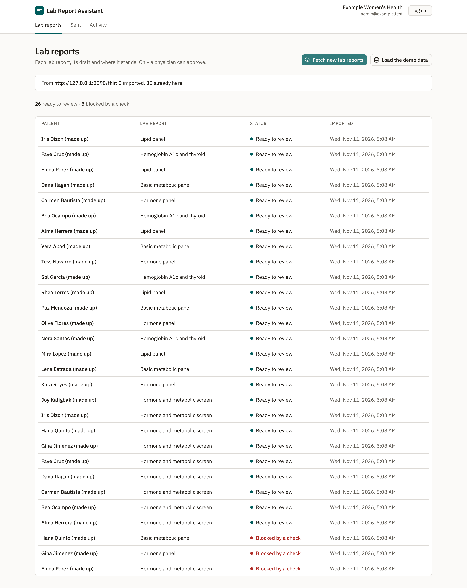
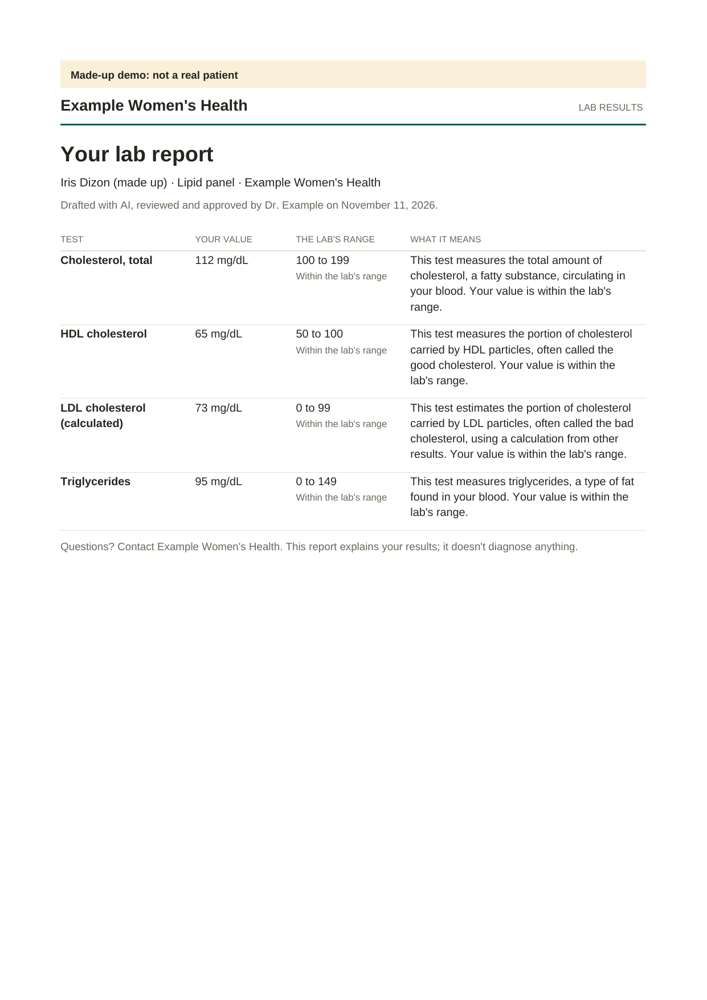

# Lab Report Assistant

An AI assistant that turns a patient's lab results into a plain-language report a physician approves. Claude drafts it; code checks every number, unit and range against the lab data and refuses anything that reads as a diagnosis; the approved text is delivered once; every step is in an append-only audit log.

**Status:** version 1 (M1–M6) and version 2 (M7–M11) done; all 49 acceptance criteria proven ([the evidence page](docs/evidence/m11.html)).

### Version 1

- **M1:** made-up lab data, strict FHIR import scoped to each clinic, and the evidence pack, which links each criterion to its passing tests.
- **M2:** Claude drafts each imported report in a background job. The model sees only the results and writes no numbers; code blocks any draft that misses a result, invents one, contains a number, puts a value on the wrong side of the lab's range, or uses diagnosis, treatment or medication wording. Claude's answers are recorded, so the tests need no API key.
- **M3:** logins by emailed link; the physician reviews each draft beside the lab's values and approves the exact text, edits it, writes it by hand or asks for a new draft (at most two); only a physician can approve; every step is in an append-only audit log the administrator can filter. Browser tests cover the journey.

- **M4:** an approval queues a notice holding no health information, only a signed link valid 30 days; it is sent once, even across a crash, and only while the approved text still stands. The patient presses "Show my report" to see the approved text beside the lab's values, with who approved it and how it was made; each opening is logged, and the Sent page shows it.

- **M5:** Claude's drafts of all 30 demo reports, recorded and put through the checks ([the report](evalset/report.md)):

  | Model | Drafts that pass every check | Cost per report |
  |---|---|---|
  | Claude Sonnet (the default) | 27 of 30 (90%) | US$0.0085 |
  | Claude Haiku | 16 of 30 (53%) | US$0.0004 |

  Haiku mostly fails by repeating test names that contain digits ("Free T4"). Of Sonnet's three failed drafts, two were blocked by the checks being cautious ("normal muscle activity" read as a placement; "not bound to proteins" read as a negation) and one for naming "ovarian reserve". Every failure was a draft held back, never one let through. The checks weren't tuned on these 30 reports, so the numbers stay honest.

- **M6:** the first showcase.

### Version 2

- **M7:** a calmer, clinical look: one teal accent, warm greys, IBM Plex Sans, amber only for a value outside the lab's range and red only for a failed check. The patient's page reads like a letter from the clinic ([the UI audit](docs/ui-audit.md)).
- **M8:** fetching lab reports from the clinic's FHIR server, tested against a real HAPI FHIR server in CI ([below](#where-the-data-comes-from)).
- **M9:** several clinics on one server, each seeing only its own reports, Sent list and activity, and fetching only from its own FHIR server.
- **M10:** the approved report as a PDF, for the patient and the physician ([a sample](docs/showcase/lab-report.pdf)).
- **M11:** the showcase below, re-recorded for version 2.

## See it

A two-minute walkthrough is in [`docs/showcase/walkthrough.mp4`](docs/showcase/walkthrough.mp4); the screenshots and how they're made are in [`docs/showcase/`](docs/showcase/README.md).

| The physician reviews Claude's draft beside the lab's own values | The patient's page, from the emailed link |
|---|---|
|  |  |
| **Lab reports fetched from the clinic's FHIR server** | **The approved report as a PDF** |
|  |  |

## Where the data comes from

- **In the demo:** 30 made-up lab reports for 20 made-up patients from a made-up lab, as FHIR R4 files in [`demo/lab-reports/`](demo/lab-reports/). FHIR is the standard format record systems and labs use to exchange health data: each file is a Bundle holding the patient, the lab report (a `DiagnosticReport`) and one `Observation` per test, with its value, unit, the lab's range and flag. They're written by a generator from a fixed seed (`cargo run -- demo-data`), and every resource carries the HL7 "test health data" label (`HTEST`), so no tool can mistake one for a real record.
- **Getting it in, from a FHIR server:** the administrator presses "Fetch new lab reports" (or the operator runs `cargo run -- fetch --clinic <ID>`). The app searches the clinic's FHIR server for its lab reports (`DiagnosticReport?category=LAB`, with each report's results and patient included), follows the server's next pages, and imports each one not imported before.
  - Every report goes through the same strict reader as a file. One it refuses is listed with the reason, and the others still import.
  - The server's address is set per clinic by the operator (`clinic set-fhir-server`): https only, except a server on this computer.
  - Each request has a time limit and each answer a size limit. A slow, oversized or non-FHIR answer imports nothing and says why.
  - Every fetch is in the audit log and on the Activity page.
  - CI runs this against a real HAPI FHIR server (v8.4.0-1).
  - For the demo, `docker compose --profile fhir up -d` starts HAPI FHIR locally, and `cargo run -- load-made-up --url http://localhost:8090/fhir` loads the made-up reports into it. That command refuses any server not on this computer, so nothing is uploaded to a public test server.
- **Getting it in, from files:** the administrator presses "Load the demo data", or `cargo run -- import --clinic <ID> <files>` imports any FHIR R4 lab Bundle. Each file is checked strictly; a broken one is refused with the reason and nothing is imported.
- **In the app:** the review page shows the lab's own file under "Lab data (FHIR R4)", exactly as imported; the results table is built from it, and Claude only writes the words beside it.
- **In a real clinic:** the same fetch would point at the clinic's record system or its lab's FHIR API. A real system needs a login first; SMART Backend Services is the next step, since test servers are open. Nothing here has seen real patient data.

## What the code enforces

- **The model never sees who the patient is:** a request carries each result's test name, code, value, unit, range and flag, nothing else (`a2_*`).
- **The model writes no numbers:** values come only from the lab data; a digit or a number in words blocks the draft (`b4_*`, `b7_*`).
- **No diagnosis or treatment:** a list of about 200 condition, drug and advice terms, matched as whole words, blocks a draft (`b6_*`); a value described on the wrong side of the lab's range blocks it too (`b5_*`).
- **A physician approves the exact text:** only a physician may approve; the approval binds a hash of the text, and any change needs approving again (`c1_*` to `c7_*`).
- **Sent once:** the notice goes through the engine's outbox; a crash mid-send never sends it twice (`d2_*`).
- **The PDF is the approved text:** the patient (after "Show my report") and the physician (from Sent) can download the report as a PDF in the patient page's design. It's made on request from the same approved text and never stored, it's refused once that text no longer stands, and every download is logged (`k1_*` to `k4_*`).
- **Every step is logged** in an append-only audit log the database refuses to change (`e1_*`, `e2_*`).
- **Each clinic sees only its own data:** its lab reports, Sent list and activity, in the pages and the API; fetching for one clinic reads only its own FHIR server (`a4_*`, `j1_*`, `j2_*`). The demo runs two made-up clinics side by side.

Each of the 49 acceptance criteria in [`docs/product/spec.md`](docs/product/spec.md) has tests named after it, and CI fails if a finished milestone's criterion has none passing ([the evidence pack](docs/evidence/m11.html)).

## Try it

```bash
docker compose up -d && cp .env.example .env
cargo run -- migrate
cargo run -- clinic add --name "Example Women's Health" --email admin@example.test
cargo run -- import --clinic <the printed ID> demo/lab-reports/*.json
cargo run -- work            # drafts them: with Claude if OWNER_ANTHROPIC_API_KEY is set, otherwise from the template
cargo run -- clinic add-physician --clinic <the ID> --email dr.example@example.test --name "Dr. Example"
pnpm --dir web install && pnpm --dir web build
WEB_DIR=web/dist cargo run -- serve   # http://127.0.0.1:3000; login emails arrive in Mailpit at http://localhost:8025
cargo nextest run --profile ci && cargo run -- evidence --commit "$(git rev-parse HEAD)"
```

Made-up clinic, made-up patients: this repository contains no real patient data and names no real company.

## Licence

All rights reserved ([LICENSE](LICENSE)). The source is published to be read, not reused. The engine, [Nudgewright](https://github.com/Enriquez-Johnmark/nudgewright), is open source under AGPL-3.0-only.
