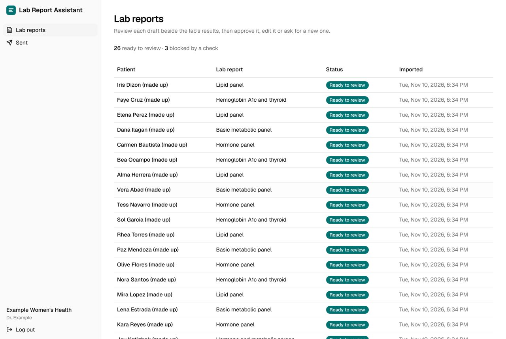
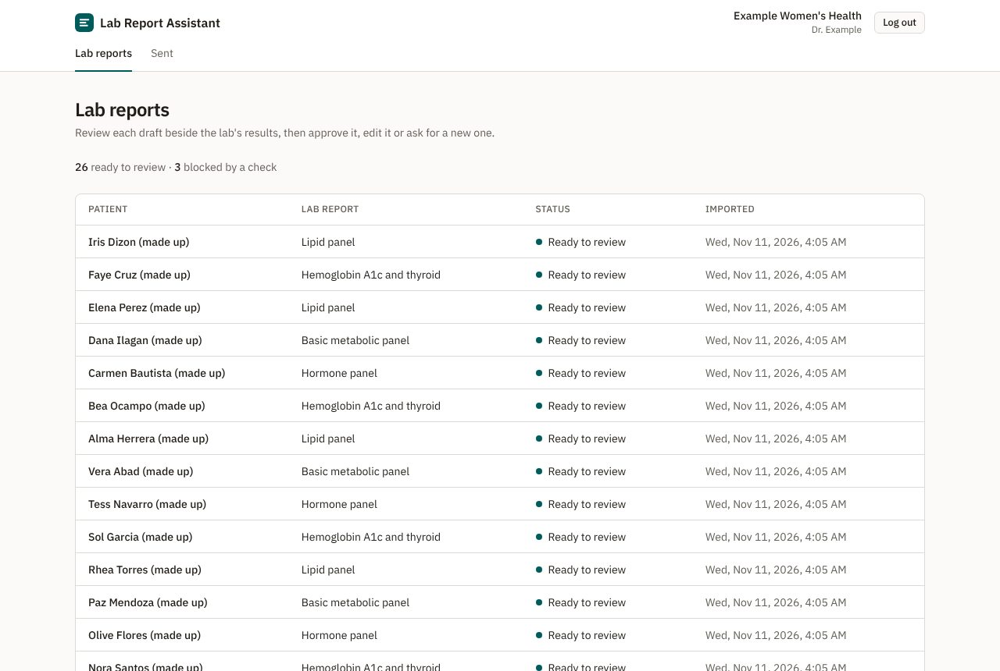
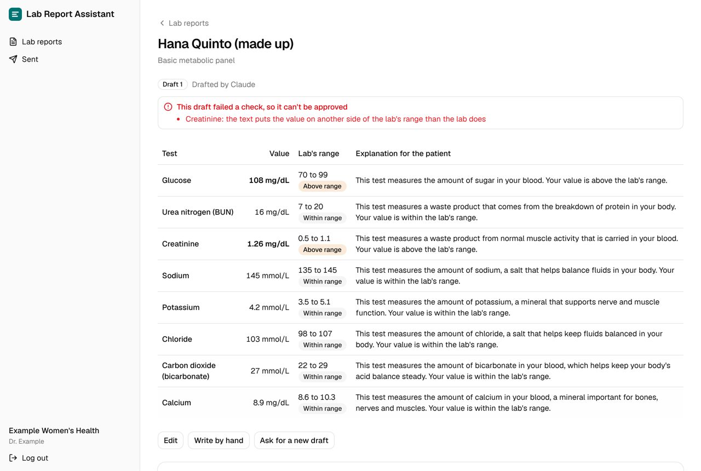
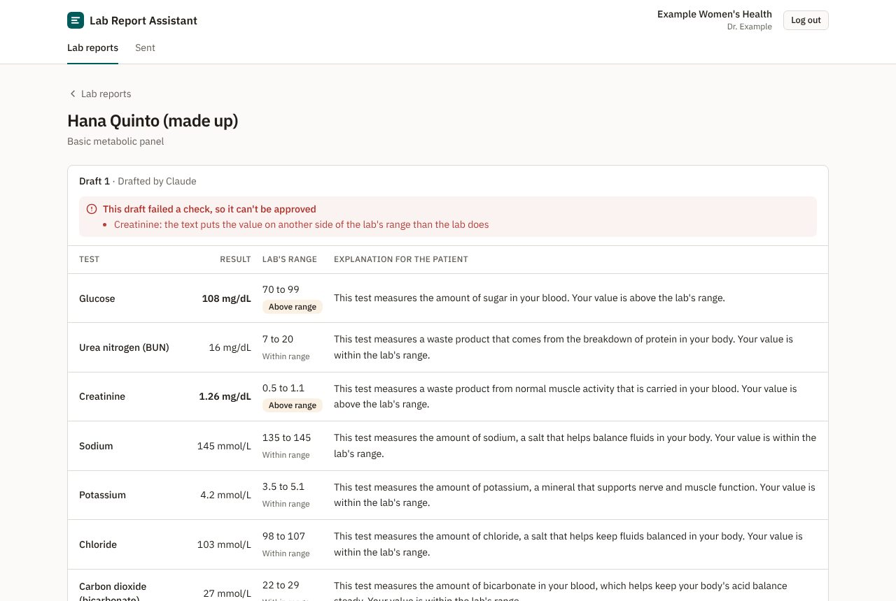
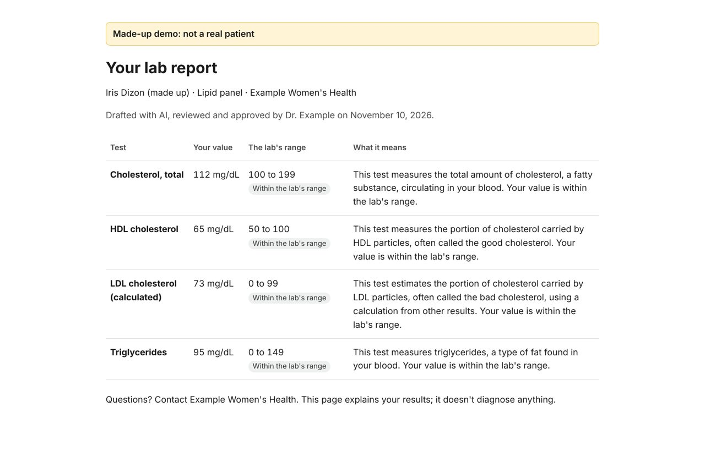
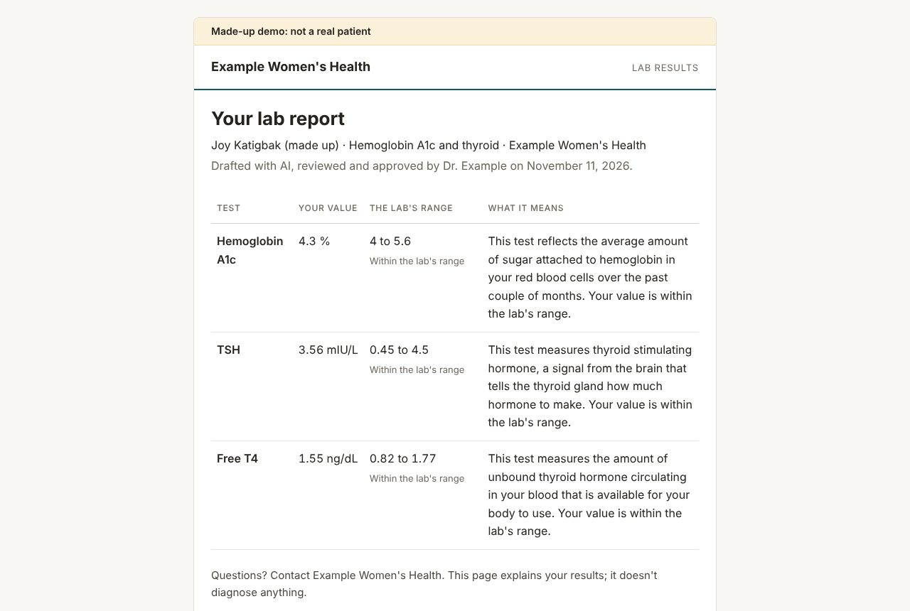

# UI audit and polish, 2026-11-10

An audit of the physician's, administrator's and patient's pages with the `ui-taste` skill (`reference/audit.md`), then a polish pass (`reference/polish.md`) that kept the existing look. Owner's decision: `docs/decisions.md`, 2026-11-10.

## What was inspected

- **Build:** `main` at `f564d63`, served by `serve --recorded` on a fresh database with the made-up clinic and its 30 demo reports.
- **Browser:** Chromium (Playwright) at 1280×860 (desktop) and 390×844 (phone, touch emulated).
- **States:**
  - the login page;
  - the empty queue, for the administrator and for the physician;
  - the full queue;
  - a draft that passed every check, and one a check blocked;
  - editing a draft, and asking for a new one (dialog);
  - approving, the Sent page (empty and with one report) and the Activity log;
  - the patient's link page and report.
- **Keyboard:** Tab order and the visible focus ring on the review page's buttons and the navigation.
- **Not checked:** a screen reader, zoom above 100%, dark mode (the app has none) and real phones; touch was emulated only.

## Findings and what was done

| # | Priority | Finding | Done |
|---|---|---|---|
| 1 | P1 | On a phone the queue pushed the Status column off screen, so the physician couldn't see which reports were ready or blocked | The lab report moves under the patient's name on a phone, so the status stays visible (`38d0b12`) |
| 2 | P1 | On a phone the review page cut off the explanation column: a physician couldn't read the text they were approving | One block per result on a phone: the test, value, range with its flag, then the explanation (`72cc842`) |
| 3 | P2 | A blocked draft's reason showed the internal result ID ("Creatinine (r3): …") | The page names the test only; the audit log keeps the ID (`2d76c17`) |
| 4 | P2 | Values outside the lab's range looked the same as the others in the review table | Set in bold beside their flag (`72cc842`) |
| 5 | P2 | The patient's page on a phone listed the value and range without saying which was which | Each value is labelled ("Your value", "The lab's range", "What it means") (`7b83e79`) |
| 6 | P2 | On the patient's page the range's flag wrapped onto two lines, and a value outside the range looked like any other | The flag is a single-line label; outside the range it is tinted and bold, and says so in words (`7b83e79`) |
| 7 | P2 | The Activity log said only "Open" for each entry's report | Each entry names the patient and the lab report; a filter with no matches says so (`72ec3d5`) |
| 8 | P3 | The queue gave no sense of how much was waiting | A line above it counts reports ready to review, blocked and drafting (`38d0b12`) |
| 9 | P3 | The physician's empty queue told them to load demo data, which only the administrator can do | It says the administrator imports lab reports (`38d0b12`) |
| 10 | P3 | The review page had no way back on a phone, where the menu is folded away | A "Lab reports" (or "Sent") link above the patient's name (`72cc842`) |
| 11 | P3 | The Sent page shows when each report was imported, not when it was approved | Left as is: the list doesn't carry the approval time yet |

**Checked and fine:**

- The keyboard focus ring shows on every button and navigation link. A first reading suggested it didn't; the full computed style showed it does.
- The login page, the new-draft dialog and the blocked-draft alert.

## Checks after the fixes

- `cargo fmt --check`, clippy and `cargo nextest run` (164 tests) passed before each commit.
- Before each web commit, `pnpm lint`, `typecheck`, `test` and `build` passed too.
- The browser tests (`pnpm e2e`, 3 tests) passed against the fixed build.
- The same states were captured again at both sizes and inspected: findings 1–10 are resolved in those captures.

# A clinical look (M7), 2026-11-11

The owner asked for pages that don't look AI-made. The `ui-taste` skill's new-work, craft and anti-slop playbooks were applied. The product, its rules and its words are unchanged, and the rules of the look are in `docs/frontend.md`. There was no image tool, so there's no generated target: the incumbent screens were the baseline, and each was captured again afterwards.

## Before and after

| Page | Before | After |
|---|---|---|
| The queue |  |  |
| A blocked draft |  |  |
| The patient's page |  |  |

## What changed

- **The frame:** shadcn's stock sidebar became a letterhead across the top: the product, then the clinic and who is logged in, with the places beneath it.
- **Colour:** one clinical teal and one warm grey family replace shadcn's neutral palette. The dark-theme tokens, still shadcn's default blue, are gone; the app is light only.
- **Type:** IBM Plex Sans, bundled, replaces Geist. Table headings are small, spaced capitals, as on a printed lab report.
- **The queue:** "Ready to review" is a small teal dot and words, not a solid teal pill on every row. The list sits on one white sheet.
- **The review page:** a report sheet. The draft's state is at the top, the ruled results table in the middle, and the actions in its footer.
  - "Within range" is quiet text; a value outside the range is bold, with a tinted label.
  - The FHIR file and the timeline are plain sections under a rule, not cards.
  - Notices are tinted bands, not boxes inside the sheet.
- **The patient's page:** a short letter on a sheet. The clinic's name sits across the top above a teal rule, then the results in the same ruled table. The PDF (M10) will follow it.

## The anti-slop counts (the skill's mechanical pre-flight)

| Check | Before | After |
|---|---|---|
| Accent hues | 2 (teal, plus shadcn's blue in the dark tokens) | 1 (teal, hue 195) |
| Grey families | shadcn's neutral (no hue) | 1 warm family (hues 75–85, chroma ≤ 0.012) |
| Meaning colours | red, amber, green | the same, each always with words: red for a blocked draft, amber for out of range, green for sent |
| Accent spent per queue row | a solid pill on every row | an 8px dot |
| Corner radii in app code | 8 steps, no rule | 3, from one rule: controls 6px, panels 8px, pills round |
| Gradients, glow, blur, emoji | 0 | 0 |
| Labels for one intent | 1 each | 1 each |
| Cards inside cards | the editor's card in the page's flow | none |

## Checks

- After each commit: `cargo fmt --check`, clippy and `cargo nextest run` (164 tests), plus `pnpm lint`, `typecheck`, `test` and `build`.
- The browser tests (`pnpm e2e`, 3 tests) pass against the new build.
- The queue, a blocked draft, the patient's link page and report, Sent, Activity and the login page were captured at 1280×860 and 390×844 and inspected.
